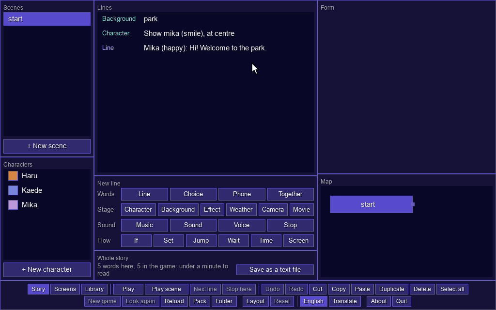
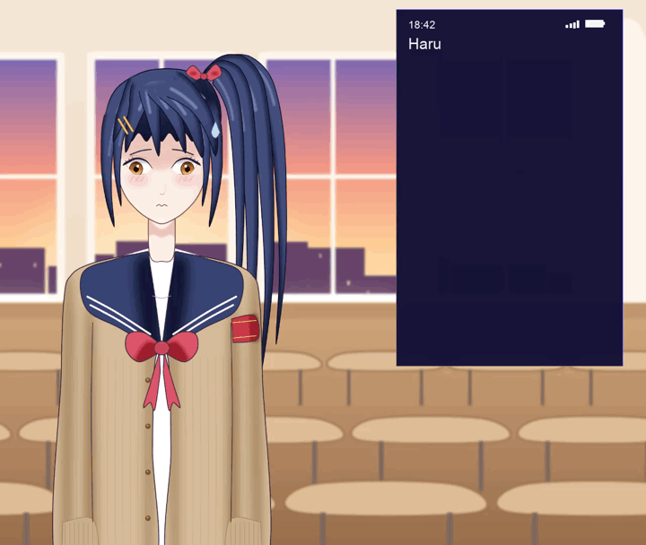
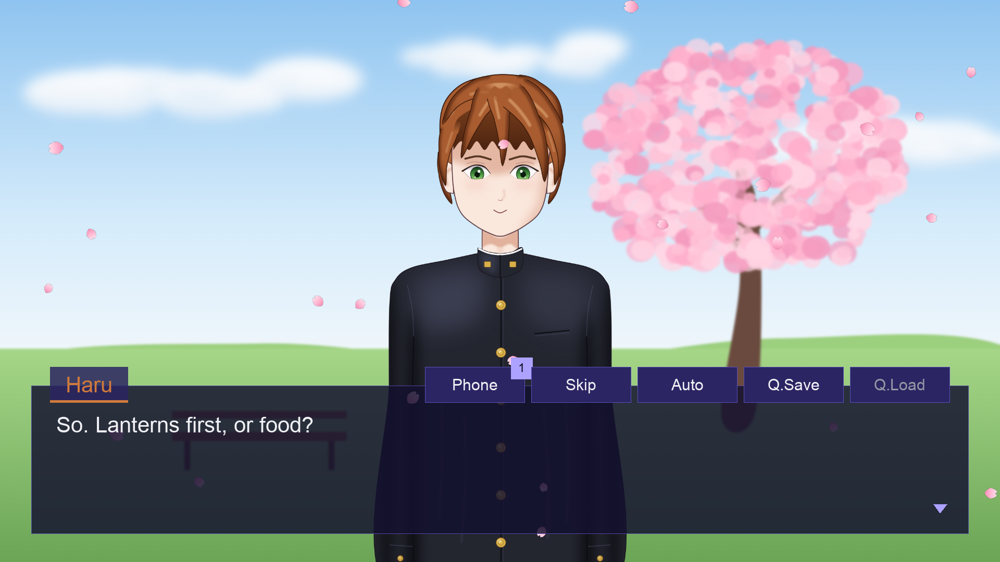
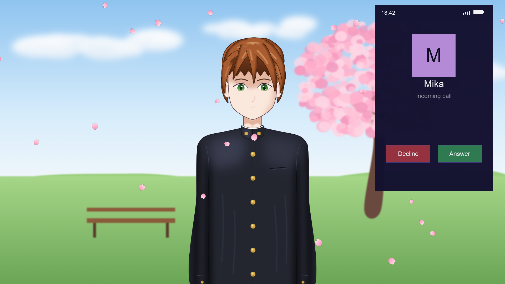
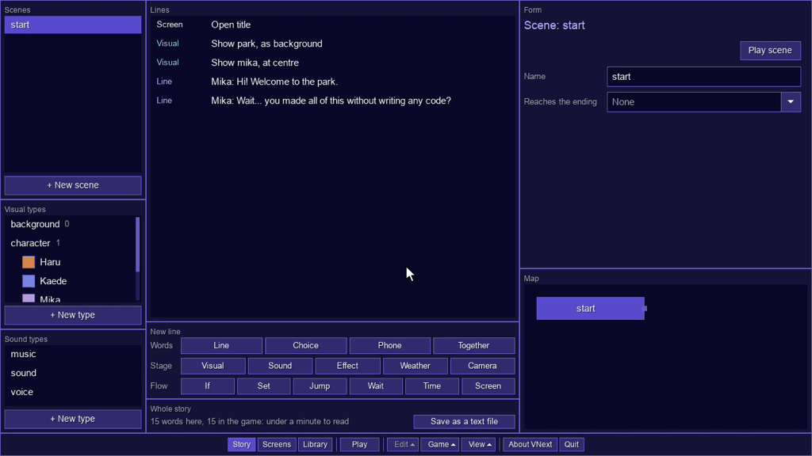
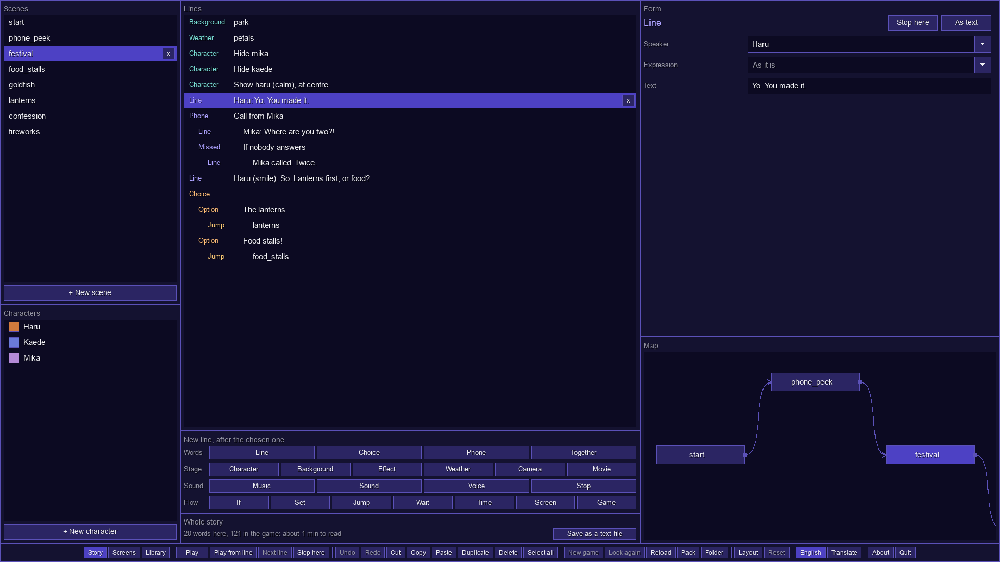
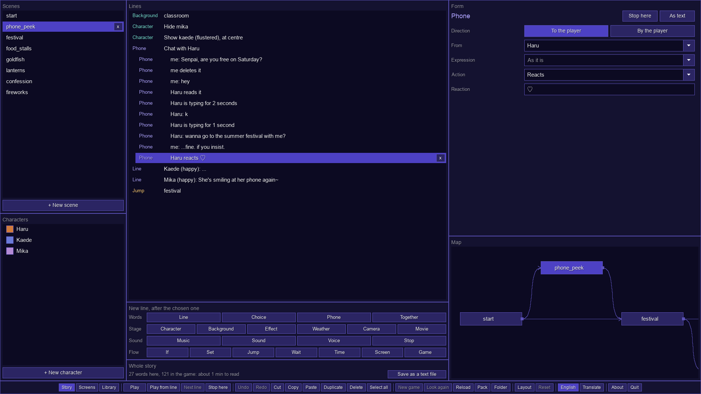
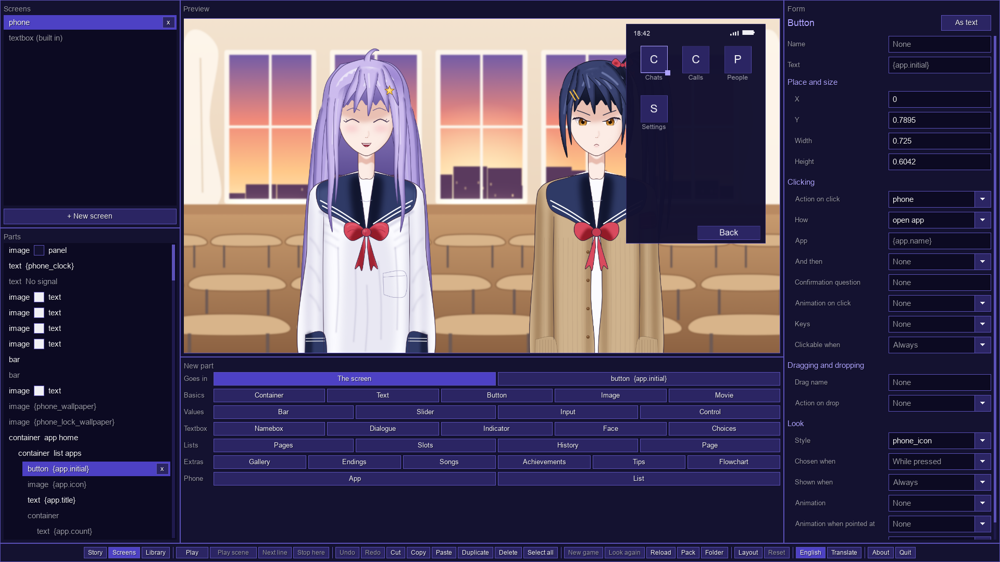
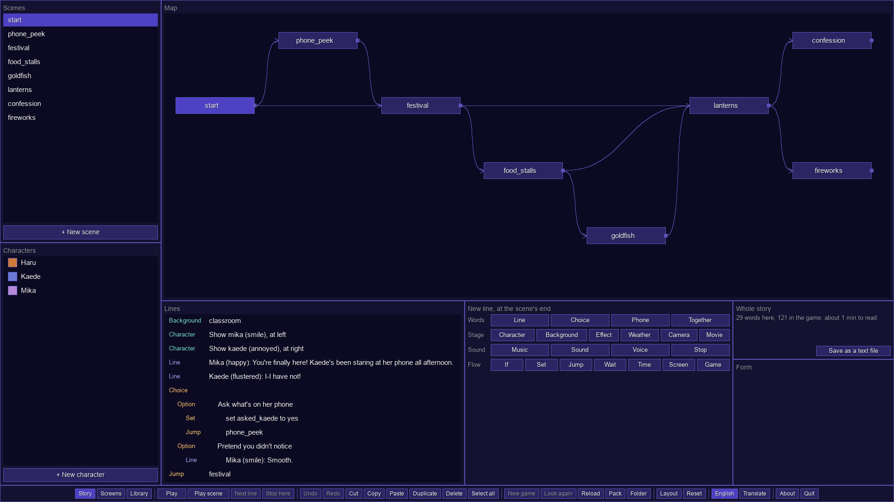

<h1 align="center"></h1>

**Make a visual novel without writing a single line of code.** VNext is one free app for Windows, macOS and Linux: you write the story, design the menus and play the game in the same window, and your characters can even text and call the player.

**[Download VNext](https://github.com/zsande/VNext/releases/latest)**: one app, nothing else to install. It's free, also for games you sell.

## Why it's easy

Most visual novel engines start with a scripting language to learn or a game engine to install. VNext starts with a window you click in.

- **No code, ever.** A scene is a list of lines you add with a click: pick who speaks and their expression from pictures, then type what they say. Menus are pictures of the game you drag things around on. Everything is also saved as plain, readable script files, if you'd rather type.
- **One app, nothing to set up.** The editor and the game are the same program: no game engine, plugins, Python or command line. Click any line and Play from line shows it in the game; F10 takes you back to the editor.
- **Menus come ready-made.** A title screen, a pause menu, saving and loading, settings, a history, a confirm question, a phone and more are a click each, already working and all yours to restyle.
- **A finished game is two files.** Pack puts every picture, sound and line into one file, game.vnext (with licences.txt beside it). Put VNext next to it and that's your game; its players' saves go inside it too.
- **Everywhere.** Make your game on Windows, macOS or Linux, and the same game.vnext plays on all three, with a mouse, a keyboard, a controller or a touch screen.
- **Free.** Also for games you sell: no royalties, no account and no splash screen of ours (zlib licence).

## The phone

Your characters text the player. Their messages type out as they write them, and they send images, stickers and voice messages, react, read what the player sends, and edit or delete what they just said. A choice in a chat shows its options on the phone, and the one picked goes out as the player's message. Calls ring until they're answered or declined, and when nobody picks up, the missed call has a story of its own. Players can text and call characters themselves, a badge on the textbox counts new messages, and controllers buzz when one comes. The phone has a lock screen with a passcode, wallpapers, apps, a clock, a date, signal and battery, all of which the story can change, and it's made of ordinary screen parts, so every bit of it can be restyled.

## Everything else your story needs

- **Characters** with expressions, eyes that blink and mouths that move as they talk, a face beside the textbox, their own name colour and textbox (speech bubbles too), and made-up "speech" or typing sounds when there's no voice.
- **Words** that can be bold, italic, underlined, crossed out or coloured, speed up or slow down, pause, appear a letter, a word or a line at a time, carry furigana, show a variable, or unlock a tip that explains them, in a textbox or as whole pages of text, novel style.
- **Choices** with a time limit, options locked until something is true or marked once picked, and menus that come back after an option. Variables and conditions keep track of everything, and some of them last between plays.
- **Time**: the story's own clock and calendar, the player's real one, or days split into morning, afternoon, evening and night. Backgrounds and the phone follow it, and a calendar shows each new day.
- **The stage**: backgrounds (images, colours or gradients), characters that come, go and move with animations, effects (greyscale, sepia, invert, blur, pixelate, noise, glitch), weather (rain, snow, petals, leaves, embers), a camera that zooms, pans and shakes, and movies.
- **Sound**: music that fades in, out and from one song to the next and quietens while someone speaks, sounds and loops, and a voice file for every line, with the words keeping time with the voice.
- **Screens**: a title screen, pause menu, saving and loading, settings, a history, a choice menu, questions, the phone, credits, a calendar and a box to type a name into, all ready-made and yours to restyle. Or build your own from parts (buttons, sliders, bars, text boxes, lists, scrolling boxes with scrollbars and fading edges), with styles, drag and drop, and animations made on a timeline.
- **Extras**: a gallery, a music room, endings, achievements, tips, and a flowchart that takes players back to any choice.
- **For players**: saves with pictures, autosave, quick save and quick load, rewind, skip and auto-play (Menu, Skip, Auto, Q.Save, Q.Load and Phone buttons on the textbox, and keys), a history that replays voices and goes back, and settings for text speed, text size, volumes, high contrast, text read aloud, language and every key and button. Every menu works with a mouse, a keyboard or a controller, with an on-screen keyboard for typing a name.
- **Every language**: translations, with a spreadsheet for translators, right-to-left scripts, Japanese and Chinese line breaking, and the developer tools themselves can be translated too.

  
  

## The editor

Open VNext in developer mode and you get an editor that fits any window size, in three tabs:

- **Story**: scenes and their lines as forms, every kind of line a button away, and the map, where every scene is a box: drag one's dot to another and the story jumps there.
- **Screens**: the title screen, menus and textbox, designed by dragging their parts around on a picture of the game.
- **Library**: images, sounds, voices, movies and fonts (drop files on the window to add them), the colours, styles, animations, variables, endings, achievements, tips and controls a game uses (with the variables' values shown as you play), the game's settings, and its translations, with a spreadsheet for translators.

Every part of a tab is a window of its own to move and resize, and the editor's buttons run along its foot: Play, or Play from line to see the game from any line, Undo and Redo, Pack and the rest, with the same keys you know. Mistakes are marked in red and said in plain words, and every change can be undone.

  
  
  
  

## How it's made

The idea, the design and the direction of VNext are mine. Every line of its code is written by Claude, an AI made by Anthropic, and so are the characters in the pictures, drawn in code. I decide what VNext should be, test what comes out and say what to change; Claude writes the code and tests it.

## Download

Get VNext from GitHub's [Releases page](https://github.com/zsande/VNext/releases): a zip for Windows, macOS or Linux, with the player and licences.txt (on Linux, the player is an AppImage). VNext isn't signed by Apple or Microsoft yet, so the first time, macOS asks you to allow it in System Settings → Privacy & Security (Open Anyway), and Windows says it protected your PC (More info, then Run anyway). The [code signing policy](CODE_SIGNING.md) says how the players are signed.

## Status

VNext is made and tested on macOS. The Windows and Linux versions are new: GitHub builds and starts them on every change, but they have had less real use. VNext is in active development and changes quickly.

## Building from source

In `engine/`, run `cmake --preset release`, then `cmake --build --preset release`. You need CMake 3.28 or newer and a recent C++ compiler (the automatic builds use Apple Clang, GCC 14 and Visual C++ 2022); SDL3 and the other libraries VNext uses are downloaded the first time. On Linux, first install the development packages listed in [the build workflow](.github/workflows/build.yml), which builds VNext for Windows, Linux and macOS.

## Licence

VNext is free to use under the [zlib licence](LICENCE.txt): you may use it, change it and share it, also in games you sell, as long as you don't claim you wrote it.
